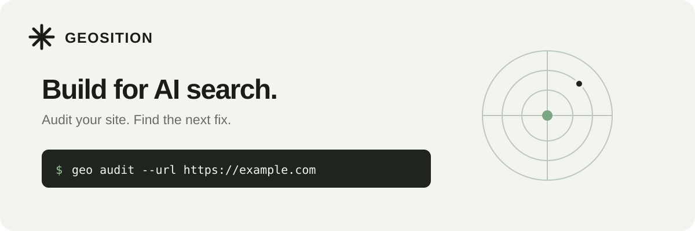

<p align="center">
  
</p>

# GEOSITION

A source-available developer toolkit for auditing websites for AI search readiness. Check crawler access, structured data, metadata, and content; then review practical suggestions for improving your site.

[](https://github.com/arnaudbellemare/geosition/actions/workflows/ci.yml)
[](https://www.python.org/)
[](LICENSE)

[Documentation](https://arnaudbellemare.github.io/geosition/) · [Website](https://geositionai.com/) · [Contributing](.github/CONTRIBUTING.md) · [Security](.github/SECURITY.md)

## Get started

Install GEOSITION and audit a public page:

```bash
python -m pip install geosition
geo audit --url https://example.com
```

The report includes a readiness score, a breakdown of checks, and suggested next steps. The score is a **heuristic**: it does not measure actual AI citations or guarantee visibility. See the [scoring rubric](docs/scoring-rubric.md) for details.

> Prefer to inspect the source first? Clone this repository and install with `python -m pip install -e ".[dev]"`.

## AI commerce readiness

Inspect one public product or service page for observable commerce signals:

```bash
geo commerce-audit --url https://example.com/product
geo commerce-audit --url https://example.com/product --format json
geo commerce-audit --url https://example.com --site --max-pages 25 --render --format json
geo commerce-audit --url https://example.com --site --max-pages 25 --render --format markdown > commerce-report.md
```

The default is a single-page, presence-only assessment. Site mode follows discovered same-origin links and sitemaps, respects robots.txt, and reports coverage and limits. Optional rendering requires Node.js, the `playwright` npm package, and a Playwright Chromium browser (`npx playwright install chromium`); set `GEO_CHROMIUM_PATH` to use an existing compatible browser. Rendering loads only securely fetched same-origin scripts and blocks browser network requests, so sites that depend on other resources may render partially. Site reports include evidence-linked recommendations and verification steps. Review generated reports before sharing. Neither mode verifies feeds, partner eligibility, browser access, or completed transactions. See the [platform and managed-service plan](docs/AI_COMMERCE_PLATFORM_PLAN.md).

### Guided commerce preparation

```bash
geo commerce-prepare --audit commerce-audit.json --output-dir commerce-draft
# After the owner edits and reviews the catalog, regenerate into a new directory:
geo commerce-prepare --catalog commerce-draft/catalog-review.json --output-dir commerce-reviewed
```

The command creates a review catalog, draft Product JSON-LD, a feed worksheet, and per-item completeness checks. Audit prices and cards are unverified; no website or provider account is changed. The worksheet is not a provider feed, and internal checks do not establish provider compliance. See the generated README for review and validation steps.

### Guided service and enquiry preparation

```bash
geo commerce-service-prepare --audit commerce-audit.json --output-dir service-draft
# After owner review, regenerate into a new directory:
geo commerce-service-prepare --review service-draft/service-review.json --output-dir service-reviewed
```

The command generates reviewable service records, draft Service JSON-LD, validation issues, and a manual enquiry test plan. Identical labels are grouped as candidates and must be reviewed; service data and observed enquiry links are not independently verified. Existing structured data should be reviewed to avoid adding duplicates. The command never submits an enquiry or changes a website.

### Recurring commerce monitoring

```bash
# First run establishes a baseline. Repeat manually, with a scheduler, or keep watch running.
geo commerce-monitor --url https://example.com/ --max-pages 25 --render
geo commerce-monitor --url https://example.com/ --max-pages 25 --render --watch --interval-seconds 86400
```

Each run saves a compact snapshot in `~/.geo-optimizer/commerce-monitor.db` (override with `--db`) and compares compatible runs. Optional `--baseline` imports a matching site-audit JSON on the first run; URL, page limit, and rendering setting must match. Monitor changes are observations, not verified sales or transaction failures. Missing pages and partial rendering are reported as unknowns; finding comparisons require complete matching coverage. Only clearly named same-origin contact links are fetched with GET. The monitor never submits a form. `--watch` runs only while its process is alive; it does not install a system schedule or notification channel.

### Discovery feed pilot

`geo commerce-feed --input candidates.json --output-dir feed-preview` checks a supported subset of the stable OpenAI discovery schema and writes JSONL with search eligibility disabled. Candidate inputs contain `items`, each with a `record` object using the required discovery fields and explicit `owner_reviewed` and `rights_confirmed` booleans; the input also has a `market_confirmed` boolean. Validation is offline and does not verify provider eligibility, field truth, links, inventory, rights or conformance to the entire schema. An enabled local export requires `--enable-search` and explicit review confirmations; no feed is uploaded by the command. Confirm Canadian market and currency support for the specific integration before relying on it.

## Common tasks

```bash
# Save a machine-readable audit
geo audit --url https://example.com --format json --output report.json

# Preview suggested fixes; --apply writes generated files to ./geo-fixes/
geo fix --url https://example.com
geo fix --url https://example.com --apply

# Audit pages from a sitemap
geo audit --sitemap https://example.com/sitemap.xml --max-urls 25
```

Review generated files before adding them to your site. Run `geo --help` or `geo <command> --help` to explore the CLI. The [command guide](docs/GEOSITION_CLI.md) covers more workflows.

## Use from Python

```python
from geo_optimizer import audit

result = audit("https://example.com")
print(result.score, result.band)
print(result.recommendations)
```

For the asynchronous API, import `audit_async`. The package also provides an [MCP server](docs/mcp-server.md) and a [GitHub Action](docs/ci-cd.md).

## What it checks

- Search crawler access and technical signals
- Structured data, page metadata, and business identity
- Content structure and product data on individual pages
- Optional discovery files, reported separately from the readiness score

The dashboard can compare sampled AI answers and connect first-party search data when the required services are configured. Search traffic and sampled citations are separate measurements; neither is inferred from the readiness score. See [search measurement setup](docs/search-measurement.md).

## Explore the repository

| Path | What you'll find |
| --- | --- |
| [`src/geo_optimizer/`](src/geo_optimizer/) | CLI, audit engine, models, web app, and MCP server |
| [`tests/`](tests/) | Unit and integration tests |
| [`docs/`](docs/) | Guides, scoring, and platform setup |
| [`examples/`](examples/) | Sample inputs and plugin example |
| [`apps/`](apps/) | Additional applications |
| [`seo/`](seo/) | Repository SEO program and sample keyword data |

See the [repository map](docs/repository-map.md) for a closer look.

## Development

```bash
git clone https://github.com/arnaudbellemare/geosition.git
cd geosition
python -m venv .venv
source .venv/bin/activate
python -m pip install -e ".[dev]"
pytest tests/ -q
ruff check src/geo_optimizer/
```

Contributions are welcome. Start with [CONTRIBUTING.md](.github/CONTRIBUTING.md), and report security issues using [SECURITY.md](.github/SECURITY.md).

## License

GEOSITION is source-available under the terms in [LICENSE](LICENSE), including the OpenAI/Anthropic rider. Read the full license before using or redistributing the software.
