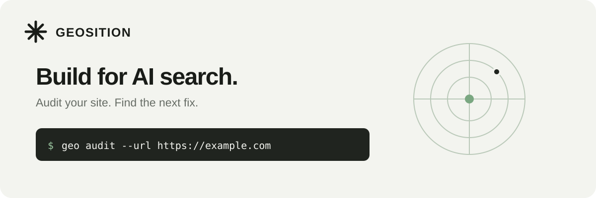

<p align="center">
  
</p>

# GEOSITION

A developer toolkit for auditing websites for AI search readiness. Check crawler access, structured data, metadata, and content; then review practical suggestions for improving your site.

[](https://github.com/arnaudbellemare/geosition/actions/workflows/ci.yml)
[](https://www.python.org/)
[](LICENSE)

[Documentation](https://arnaudbellemare.github.io/geosition/) · [Website](https://geositionai.com/) · [Contributing](CONTRIBUTING.md) · [Security](SECURITY.md)

## Get started

Install GEOSITION and audit a public page:

```bash
python -m pip install geosition
geo audit --url https://example.com
```

The report includes a readiness score, a breakdown of checks, and suggested next steps. The score is a **heuristic**: it does not measure actual AI citations or guarantee visibility. See the [scoring rubric](docs/scoring-rubric.md) for details.

> Prefer to inspect the source first? Clone this repository and install with `python -m pip install -e ".[dev]"`.

## Common tasks

```bash
# Save a machine-readable audit
geo audit --url https://example.com --format json --output report.json

# Preview suggested fixes; --apply writes generated files to ./geo-fixes/
geo fix --url https://example.com
geo fix --url https://example.com --apply

# Audit pages from a sitemap
geo audit --sitemap https://example.com/sitemap.xml --max-urls 25
```

Review generated files before adding them to your site. Run `geo --help` or `geo <command> --help` to explore the CLI. The [command guide](docs/GEOSITION_CLI.md) covers more workflows.

## Use from Python

```python
from geo_optimizer import audit

result = audit("https://example.com")
print(result.score, result.band)
print(result.recommendations)
```

For the asynchronous API, import `audit_async`. The package also provides an [MCP server](docs/mcp-server.md) and a [GitHub Action](docs/ci-cd.md).

## What it checks

- Search crawler access and technical signals
- Structured data, page metadata, and business identity
- Content structure and product data on individual pages
- Optional discovery files, reported separately from the readiness score

The dashboard can compare sampled AI answers and connect first-party search data when the required services are configured. Search traffic and sampled citations are separate measurements; neither is inferred from the readiness score. See [search measurement setup](docs/search-measurement.md).

## Explore the repository

| Path | What you'll find |
| --- | --- |
| [`src/geo_optimizer/`](src/geo_optimizer/) | CLI, audit engine, models, web app, and MCP server |
| [`tests/`](tests/) | Unit and integration tests |
| [`docs/`](docs/) | Guides, scoring, and platform setup |
| [`examples/`](examples/) | Sample inputs and plugin example |
| [`apps/`](apps/) | Additional applications |
| [`seo/`](seo/) | Repository SEO program and sample keyword data |

See the [repository map](docs/repository-map.md) for a closer look.

## Development

```bash
git clone https://github.com/arnaudbellemare/geosition.git
cd geosition
python -m venv .venv
source .venv/bin/activate
python -m pip install -e ".[dev]"
pytest tests/ -q
ruff check src/geo_optimizer/
```

Contributions are welcome. Start with [CONTRIBUTING.md](CONTRIBUTING.md), and report security issues using [SECURITY.md](SECURITY.md).

## License

GEOSITION is source-available under the terms in [LICENSE](LICENSE), including the OpenAI/Anthropic rider. Read the full license before using or redistributing the software.
